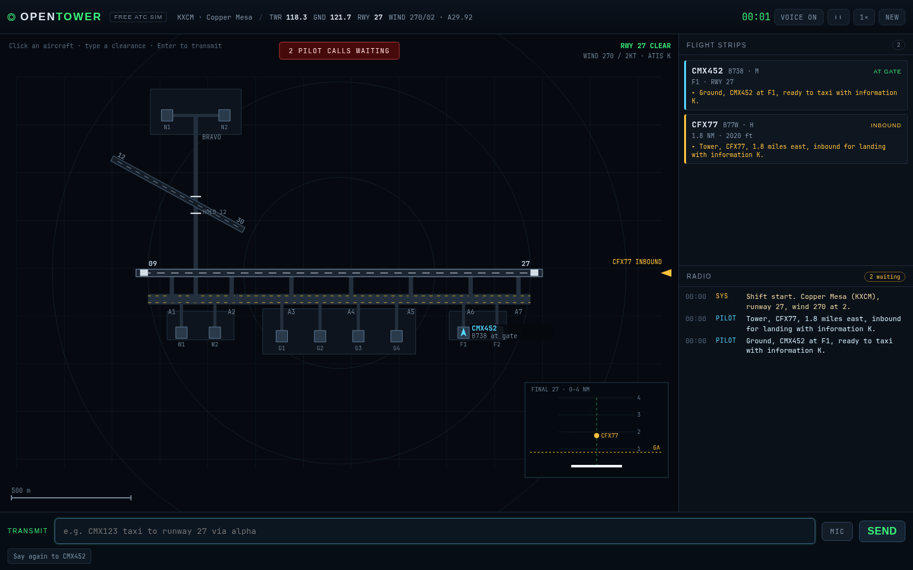
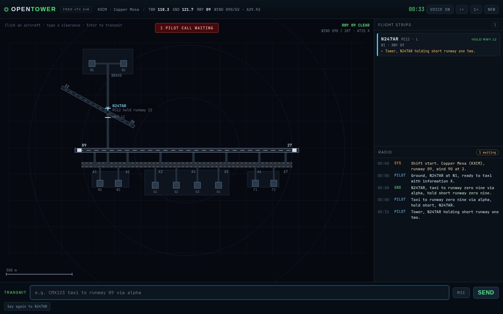
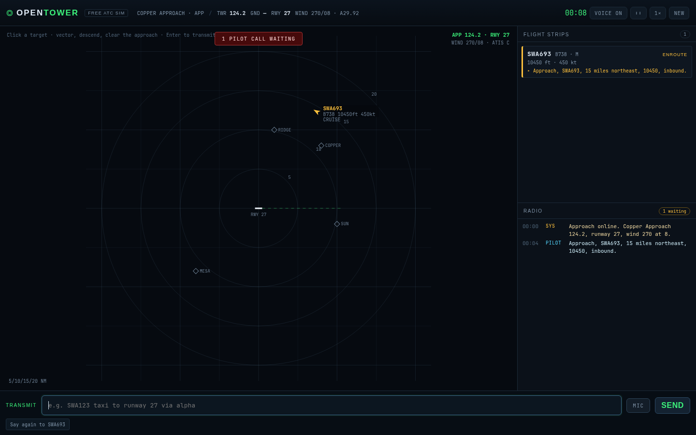

# OpenTower

[](https://github.com/TheAlexUbe/opentower/actions/workflows/ci.yml)

**Simulador ATC gratuito y open source para navegador.** Trabaja Ground y Tower
en Copper Mesa (KXCM), cruza la pista 12 del ramal norte, o ponte en el radar de
aproximación y vectoriza llegadas. Los pilotos llaman, leen de vuelta y cometen
errores; tú das las autorizaciones por texto o por voz.

**Demo:** https://thealexube.github.io/opentower/

- Sin cuenta, sin paywall, sin backend.
- Todo corre en el navegador (HTML + módulos ES, sin build).
- Interfaz y radio bilingües (inglés/español), con TTS local y STT Web Speech.
- METAR real de KPHX (NWS) que fija viento, altímetro y pista activa; si no hay
  red, usa viento simulado.
- Instalable como PWA y funcional offline.
- Código original, licencia MIT.




## Navegadores

| Navegador | Juego | TTS | STT (MIC) |
|---|---|---|---|
| Chrome / Edge | Sí | Sí | Sí, requiere servicio de voz |
| Firefox | Sí | Sí | No garantizado |
| Safari | Sí | Sí | No garantizado |
| Brave | Sí | Sí | Bloqueado por el servicio de voz |

El juego, el teclado, los tests y el modo offline no dependen de ninguna API de
voz. Si el STT falla, la app muestra el error y permite escribir la autorización.

## Arrancar

```bash
cd opentower
python3 -m http.server 8080
# abre http://127.0.0.1:8080
```

También vale cualquier servidor estático (`npx serve`, nginx, GitHub Pages…).
No abras `index.html` con `file://`: los módulos ES y el service worker necesitan
HTTP.

### Instalar como app (PWA)

En Chrome/Edge, icono de instalar en la barra de direcciones (o menú →
*Instalar OpenTower*). Una vez cargada, la app funciona offline; el METAR en vivo
solo se actualiza cuando hay red.

## Escenarios incluidos

| Escenario | Qué practica |
|---|---|
| Free shift | Tráfico continuo con duración y densidad a elegir |
| First shift | Una salida y una llegada, ritmo tranquilo |
| Morning push | Cuatro salidas y una llegada intercalada |
| Heavy arrival | Un 777 con separación de estela y un 737 detrás |
| North ramp | Rodaje al ramal norte cruzando la pista 12 |
| Approach final | Modo TRACON: vectores, descenso, ILS y handoff a torre |

Cada escenario tiene objetivos (aeronaves atendidas e incidencias máximas) que
aparecen en el debrief.

## Torre y Ground

1. Elige escenario y pulsa **Start free shift**.
2. Haz clic en una aeronave o en su *strip*.
3. Escribe la autorización y pulsa Enter. El indicativo va delante.
4. La pista activa la decide el viento (09 o 27). Si pides la otra, el piloto
   responde *unable*.
5. Las llegadas lejanas aparecen en el inset **FINAL 0–4 NM** antes de la
   decisión de go-around.

| Situación | Transmisión |
|---|---|
| Salida en puerta | `N123AB taxi to runway 27` |
| Salida en puerta | `N123AB taxi to runway 27 via alpha` |
| Espera | `N123AB hold short of runway 27` |
| En el punto de espera | `N123AB line up and wait` |
| Alineado | `N123AB cleared for takeoff` |
| Llegada en final | `SWA123 cleared to land` |
| Llegada en final | `SWA123 go around` |
| Tras aterrizar | `N123AB taxi to the ramp` |
| Rodaje | `N123AB continue taxi` |
| Radio | `N123AB say again`, `N123AB standby`, `N123AB roger` |

### Radio en español

En **RADIO LANGUAGE · IDIOMA** elige **Español** antes de empezar el turno.
Cambia a la vez:

- la fraseología ATC/piloto y los readbacks;
- el idioma del reconocimiento de voz (`es-ES`);
- la voz TTS de los pilotos;
- los botones rápidos y los avisos operativos.

El parser acepta inglés o español aunque elijas uno; la radio responde en el
idioma seleccionado. También entiende el alfabeto fonético español y variantes
como `Alfa`, `Eco`, `Julieta`, `Equis`, `Yanqui`, `Uve doble`, `Whisky` y
`Niner`.

| Situación | Transmisión en español |
|---|---|
| Salida en puerta | `N123AB ruede a la pista 27 por alfa` |
| Indicativo deletreado | `N uno dos tres alfa bravo, ruede a la pista 27` |
| Espera | `N123AB alto antes de la pista 27` |
| En el punto de espera | `N123AB alinéese y espere` |
| Alineado | `N123AB autorizado para despegar` |
| Llegada en final | `SWA123 autorizado para aterrizar` |
| Frustrada | `SWA123 frustrada` |
| Tras aterrizar | `N123AB ruede a la plataforma` |
| Cruce de la 12 | `N123AB cruce la pista 12` |
| Radio | `N123AB repita`, `N123AB espere`, `N123AB recibido` |

En Approach: `gire a la izquierda`, `descienda y mantenga 3000`,
`velocidad 180`, `autorizado ILS`, `contacte torre`, `contacte centro`.

### Pista 12 y ramal norte

Las puertas **N1/N2** están al otro lado de la inactiva **12/30**. Al llegar al
punto de espera, la aeronave llama *"holding short runway one two"*. Autoriza el
cruce con:

```
N123AB cross runway 12
```

Después continúa al punto de espera de la pista activa (o a su puerta, si es una
llegada). Si no autorizas el cruce, se queda esperando y cuenta como tráfico
pendiente.



## Modo Approach (TRACON)

El escenario **Approach final** abre un radar de área de 20 NM. Las llegadas
entran a 12–16 NM y 6.000–9.000 ft; tienes que vectorizarlas, bajarlas y
establecerlas en la final antes de 4 NM.

| Acción | Transmisión |
|---|---|
| Viraje | `SWA123 turn left`, `SWA123 turn right` |
| Rumbo | `SWA123 fly heading 270` |
| Altitud | `SWA123 descend and maintain 3000` |
| Ascenso | `SWA123 climb and maintain 6000` |
| Velocidad | `SWA123 speed 180` |
| Aproximación | `SWA123 cleared ILS` |
| Handoff | `SWA123 contact tower` |
| Salida | `SWA123 contact center` |
| Frustrada | `SWA123 go around` |

La aproximación exige estar a menos de 12 NM y dentro del localizador (1,5 NM laterales, 20°); si te desvías más de 2,5 NM, el piloto se va al aire.
Una vez establecida, la aeronave sigue la senda de 3°. Si no la autorizas antes
de 4 NM, o no la entregas a torre antes de 1,5 NM, se va al aire. La separación
mínima es 3 NM / 1.000 ft.



## Voz

- **MIC** (o tecla `M`): reconocimiento de voz del navegador. Usa `en-US` o
  `es-ES` según **RADIO LANGUAGE · IDIOMA**. Funciona en Chrome/Edge; **Brave y
  algunos Chromium no implementan el servicio de Google** y devuelven `network`.
  La app muestra el error y el teclado sigue disponible. El texto reconocido se
  envía como transmisión y queda registrado como `MIC:` en la radio.
- **VOICE ON/OFF** (o tecla `V`): lee las respuestas de los pilotos con
  `speechSynthesis`.
- Si el navegador no soporta reconocimiento, el botón MIC queda deshabilitado.
- No hay backend propio: el TTS usa las voces del sistema. El STT lo gestiona
  el navegador y, en Chrome/Edge, puede usar su servicio de voz; Brave no lo
  soporta. Si falla, escribe la autorización.

## Meteorología

Al iniciar se consulta la observación más reciente de **KPHX** en
`api.weather.gov` (CORS abierto). Se usan viento, ráfagas, altímetro, visibilidad
y temperatura; el viento elige la pista activa. Si la consulta falla o está
desactivada, se usa viento simulado y se indica `SIM WX`.

## Puntuación

- **Safety /40**: incursiones, conflictos de rodaje o aéreos, estela, go-arounds.
- **Communication /30**: rapidez de respuesta y autorizaciones incorrectas.
- **Traffic /30**: aeronaves atendidas, salidas retenidas y tráfico pendiente.

Al final hay debrief con nota A+…F, desglose, objetivos e incidencias. La mejor
nota se guarda en `localStorage` por escenario y dificultad, con lectura segura
(si el almacenamiento está bloqueado, la app sigue funcionando).

## Atajos

- `Space` pausa/continúa.
- `1`, `2`, `4` fijan la velocidad de simulación.
- `M` activa/desactiva el micrófono; `V` silencia las voces.
- `Esc` quita la selección.
- `/` o `Enter` enfocan la radio.
- Botones rápidos contextuales bajo la radio.

## Arquitectura

```
index.html
styles.css
src/
  config.js       tipos de aeronave, aerolíneas, geometría de KXCM
  airport.js      rutas de rodaje, ramal norte y cruce de la 12
  phraseology.js  parser de intenciones + frases y readbacks
  i18n.js         diccionario EN/ES y formateador puro
  engine.js       torre: reloj, movimiento, clearances, conflictos, scoring
  render.js       radar de torre en canvas
  tracon.js       motor y radar de aproximación (TRACON)
  weather.js      METAR/observación NWS y selección de pista
  scenarios.js    escenarios y objetivos
  scenario-state.js  estado puro de escenario/dificultad
  main.js         UI, bucle, strips, radio, voz
tests/engine.test.mjs
tests/tower-fixes.test.mjs
tests/tracon.test.mjs
tests/i18n.test.mjs
tests/ui-state.test.mjs
.github/workflows/ci.yml
manifest.webmanifest
sw.js
```

- **Motor puro**: `engine.js` no toca el DOM. `tracon.js` contiene el motor
  (testeable en Node) y su renderer de canvas.
- **Determinista**: PRNG con semilla; misma semilla, mismo tráfico.
- **Sin dependencias**: módulos ES nativos, sin frameworks ni CDN.
- **Datos**: aeropuerto, tipos y libreas ficticios o valores típicos.
- **Capas verificadas**: [`docs/ARCHITECTURE.md`](docs/ARCHITECTURE.md) documenta
  el mapa de capas real y el análisis del grafo (god nodes, ciclos de imports y
  deuda técnica). El grafo se regenera con `graphify .` y no se commitea.

## Tests

```bash
npm test          # todos los tests
```

Cubren parser, geometría, salida y llegada completas, puntuación, escenarios,
cruce de la pista 12 con cerrojo de ocupación, modo TRACON (go-around, localizador,
vector, descenso, ILS y handoff), cancelación de despegue, hold short, validación
de pista, inset de final, estado de escenarios, puntuación sin llamadas
respondidas, handoffs por distancia, i18n EN/ES, fraseología fonética en inglés y
español, radio en español, diagnóstico de voz, TTS fonético y eventos STT.
Incluye un bot de 300 s para detectar bloqueos.

## Alcance

Incluido: Ground + Tower, pista 09/27, pista 12/30 inactiva con cruces, ramal
norte, salidas/llegadas, taxi, line up, takeoff, landing, go-around, conflictos,
estela, meteorología real, voz local, TRACON, escenarios, PWA offline y debrief.

No incluido (todavía): 8 aeropuertos, SIDs/STARs reales, multiplayer, IA en
nube. Es un simulador independiente y original, no un clon.

## Roadmap

- **Ahora:** estabilidad de puntuación y handoffs, i18n completa, accesibilidad,
  PWA con actualización controlada, CI y Pages.
- **Siguiente:** tutorial interactivo de primer turno, más escenarios, checklist
  de TRACON y separación de estela más detallada.
- **Más adelante:** SIDs/STARs, más aeropuertos, multiplayer y perfiles de
  dificultad avanzados.

## Contribuir

Las contribuciones son bienvenidas. Lee [`CONTRIBUTING.md`](CONTRIBUTING.md) y
respeta el [`CODE_OF_CONDUCT.md`](CODE_OF_CONDUCT.md). Abre un issue antes de un
cambio grande. Para vulnerabilidades usa [`SECURITY.md`](SECURITY.md): no abras
un issue público.

## Versión

Versión actual: **1.0.0**. El historial está en [`CHANGELOG.md`](CHANGELOG.md) y
las notas de cada versión en
[GitHub Releases](https://github.com/TheAlexUbe/opentower/releases).

## Licencia

MIT. Ver `LICENSE`.
